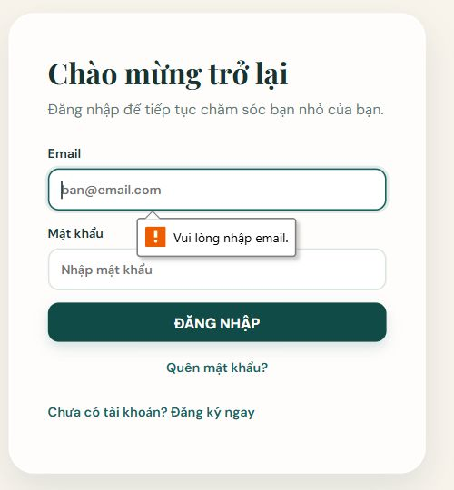

# Báo cáo kiểm thử PetNoVa — 26/10/2026

Website đã được sửa và khởi động lại tại http://localhost:5173/, API tại http://127.0.0.1:5200. Bản build React và backend đều thành công. Đợt này có **88 kiểm tra tự động đạt**, phân theo phạm vi bên dưới; đây không phải 88 test case hoàn chỉnh trong Excel.

## Tài liệu và phạm vi

Nguồn: `D:\Hk1 năm 3\LT_KDCLPM\Nhóm09\Nhóm09FullnewsPetNoVa.xlsx`. Đã đọc 12 sheet testcase, tổng 273 ca; giữ nguyên file nguồn. Sheet GUI CHECKLIST có 20 mục, dấu `x` không được coi là kết quả đã chạy.

File nguồn có cả ghi chú thiết kế/chưa thực thi và một số trạng thái Passed. Báo cáo này chỉ dùng kết quả có bằng chứng của đợt kiểm thử hiện tại.

Đối chiếu chi tiết: [CSV mở bằng Excel](doi-chieu-testcase.csv), [JSON đầy đủ](doi-chieu-testcase.json).

| Trạng thái đối chiếu 273 ca gốc | Số ca |
|---|---:|
| Có kiểm tra một phần, còn bước/lớp chưa xác nhận | 66 |
| Chưa có bằng chứng thực thi được đối chiếu | 207 |
| Đã chứng minh đầy đủ mọi bước của ca gốc | 0 |

Không gán Passed cho một ca gốc chỉ vì unit test hoặc controller test tương ứng đạt.

## Quy trình đã thực hiện

1. Đọc yêu cầu, tách mã ca/tiền điều kiện/từng bước và kết quả mong đợi.
2. Kiểm tra mã nguồn và tái hiện lỗi bằng các bộ hồi quy có đầu vào xác định.
3. Tạo bản sao SQL Server `PetNoVaDB_QA_20261026`, giữ cấu trúc và ràng buộc thật; chạy các thao tác ghi tại đây.
4. Sửa lỗi, chạy lại kiểm tra hồi quy và tích hợp.
5. Khởi động lại backend/Vite, xác nhận schema thanh toán và kiểm tra HTTP trên phiên bản mới.
6. Lưu kết quả, ảnh giao diện và đối chiếu phạm vi còn thiếu.

## Kết quả thực thi

| Bộ kiểm tra | Đạt / tổng | Phạm vi và giới hạn |
|---|---:|---|
| React/JavaScript | 19/19 | Helper đăng ký, validation thú cưng/ảnh, tải dữ liệu; mô phỏng hook/component với API trì hoãn. Chưa phải browser E2E. |
| Logic API | 16/16 | Gọi phương thức thật qua DLL; không dùng SQL/HTTP/Firebase. |
| Controller + SQL | 34/34 | Ghi/đọc SQL bản sao thật, kiểm tra trạng thái/quyền sở hữu và yêu cầu đồng thời. Danh tính Firebase giả lập trong HttpContext; webhook dùng SDK xác minh HMAC cục bộ với khóa QA giả. |
| HTTP đang chạy | 19/19 | Health, thiếu/sai token, reset không hợp lệ, webhook sai chữ ký. Không chứng minh luồng đăng nhập hay thanh toán thành công. |

Bằng chứng: [frontend.xml](frontend.xml), [API sau sửa](api-after.json), [SQL sau sửa](sql-integration.json), [HTTP](http.json).

`npm run build` thành công với Vite 7.3.7. `npm audit` báo 0 cảnh báo tại thời điểm chạy. NuGet không liệt kê gói có lỗ hổng trong kết quả audit sau cập nhật. Điều này chỉ là kết quả của nguồn advisory đang được công cụ sử dụng, không phải chứng nhận website an toàn tuyệt đối.

## Lỗi đã khắc phục

| Vấn đề | Cách sửa và bằng chứng |
|---|---|
| Công suất đặt lịch đếm tổng số lịch giao nhau, từ chối sai khi ba lịch nối tiếp nhau | Tính số lịch đồng thời theo các mốc bắt đầu/kết thúc; kết thúc được xử lý trước bắt đầu cùng giờ. API hồi quy trước: 10 đạt/6 lỗi, sau: 16/16 đạt. |
| Giờ có phần mili giây vẫn lọt bước 30 phút; giá dịch vụ không vừa decimal(18,2), thời lượng quá giới hạn, trạng thái lạ | Siết validation theo SQL và quy tắc đặt lịch. Có ca biên hợp lệ và không hợp lệ trong bộ 16 kiểm tra API. |
| Retry thanh toán FAILED bị unique constraint bookingId chặn | Thay ràng buộc cũ bằng unique index chỉ cho PENDING và index lịch sử. Đã chạy migration trên QA trước, sau đó backend áp dụng vào PetNoVaDB khi khởi động. Metadata xác nhận index PENDING tồn tại và constraint cũ đã bỏ. |
| Hai yêu cầu thử lại cùng lúc có thể tạo giao dịch chờ trùng | Dùng transaction và khóa nghiệp vụ chung với lịch hẹn, cùng unique index PENDING. SQL kiểm tra nhận đúng 201 và 409, chỉ một PENDING. |
| Hai lần xác nhận tiền mặt đồng thời cùng trả thành công | Tái hiện trước sửa: 204 và 204. Sau khi khóa transaction: 204 và 409. [Bằng chứng trước](sql-confirm-before.json), [sau](sql-integration.json). |
| Xác nhận và đánh dấu thất bại cùng thành công; ghi nhận hoàn tiền lặp tạo thông báo trùng | Cả hai tình huống tái hiện 204/204 trước sửa. Dùng cùng khóa transaction cho các thao tác thay đổi trạng thái; sau sửa nhận 204/409, hoàn tiền chỉ tạo một thông báo. [Trước](sql-other-payment-before.json), [sau](sql-integration.json). |
| Webhook hợp lệ đến đồng thời tạo hai thông báo PAID | SDK thật xác minh fixture HMAC cục bộ. Tái hiện trùng thông báo trước sửa; sau sửa cả hai webhook được ACK nhưng chỉ ghi một thông báo. Đồng bộ PayOS cũng đọc lại trạng thái dưới khóa sau khi nhận phản hồi mạng. [Trước](sql-webhook-before.json), [sau](sql-integration.json). Chưa xác nhận kết nối PayOS thật. |
| Trang khách gọi API chi tiết/thanh toán theo từng lịch và che lỗi thành danh sách rỗng | Tải hai danh sách theo lô, giữ lỗi cho giao diện xử lý. Fixture 1.000 lịch chỉ phát sinh hai request tải chi tiết/thanh toán trong helper. |
| Phản hồi cũ ghi đè dữ liệu thú cưng/khoảng báo cáo vừa chọn | Hủy/đánh số request, xóa dữ liệu cũ khi tải thất bại. Bộ mô phỏng component tái hiện 5 lỗi trên ref e573b91, sau sửa 5/5 đạt; còn cần kiểm tra VET/ADMIN thật trên trình duyệt. |
| UI cho ảnh 6 MiB trong khi API chỉ nhận 5 MiB; dữ liệu thú cưng/ghi chú không khớp API | Đồng bộ 5 MiB, giới hạn chuỗi, giống bắt buộc, ngày sinh, cân nặng và ghi chú 255 ký tự. Nếu tạo hồ sơ thành công nhưng upload lỗi, giữ ID để thử lại không tạo trùng hồ sơ. |
| Đăng ký lỗi hồ sơ có thể để lại danh tính vừa tạo | Kiểm tra trước khi gọi Firebase; xóa riêng danh tính mới khi bị API từ chối dứt khoát. Không xóa khi mạng/5xx chưa rõ SQL đã lưu hay chưa. Có 7 kiểm tra helper; chưa thử tài khoản Firebase thật trong đợt này. |
| API nhận tên chỉ có khoảng trắng hoặc quá cột SQL | Chặn tên rỗng, giới hạn 100 ký tự, trim tên; có kiểm tra ghi SQL tại biên 100/101. Tái sử dụng danh tính đã được filter xác minh để tránh gọi Firebase hai lần. |
| Thông báo native form bằng tiếng Anh | Thêm xử lý validation tiếng Việt chung. Bấm form rỗng trên trình duyệt thật đã thấy “Vui lòng nhập email”, “Vui lòng nhập họ và tên”, “Vui lòng nhập tên bé”. |
| Nội dung trang khách tràn ngang ở màn hẹp | Chỉnh grid/min-width và để thanh điều hướng cuộn trong vùng riêng. Có lần đo viewport 390 px sau sửa: chiều rộng nội dung 375 px, menu cuộn trong vùng chứa. Chưa xác nhận đầy đủ mọi trang/kích thước. |
| Cảnh báo bảo mật thư viện | Cập nhật Vite 7.3.7, khóa các phụ thuộc có bản vá; thêm PKCS 9.0.21. Audit npm trước báo 6 nút package mức high, sau báo 0; NuGet trước cảnh báo 2 advisory của PKCS, sau không liệt kê gói bị ảnh hưởng. |

Bộ hồi quy trước/sau: [api-before.json](api-before.json), [api-after.json](api-after.json), [van-hanh-before.xml](van-hanh-before.xml), [frontend.xml](frontend.xml). Audit sau: [npm](npm-audit.json), [NuGet](nuget-audit.json).

Ảnh chụp vùng form đăng nhập sau sửa thông báo:

## Kiểm tra giao diện thật đã thực hiện

- Phiên CUSTOMER thật: mở danh sách thú cưng có dữ liệu, đặt lịch, lịch sử thanh toán, sức khỏe và tài khoản; kiểm tra tiêu đề/điều khiển hiển thị, không thấy alert lỗi trên các trang đã đọc.
- Mở form thú cưng mới, bấm lưu khi trống để xác nhận bị chặn, rồi hủy. Không tạo thú cưng thật bằng bước kiểm tra này.
- Kiểm tra form đăng nhập và đăng ký rỗng; không nhập mật khẩu mới hay tạo tài khoản Firebase.
- Sau khởi động lại, trang đăng nhập tải được, console error ghi nhận là danh sách rỗng tại lần đọc.

Ảnh mobile chỉ là bằng chứng cục bộ; công cụ viewport có lúc thay đổi kích thước theo vùng hiển thị. Chưa kết luận responsive của toàn bộ website đạt. Ảnh điều hướng sau sửa chỉ chụp phần đầu trang.

## Phần chưa xác nhận và việc cần tiếp tục

1. **ADMIN/STAFF/VET trên trình duyệt thật:** hiện tab vẫn ở trang đăng nhập. Cần người dùng đăng nhập từng tài khoản thử nghiệm; chưa xem kết quả controller/mô phỏng component là thay thế cho bước này.
2. **Firebase và OTP đầy đủ:** chưa tự tạo tài khoản thật, chưa gửi OTP thật hoặc đổi mật khẩu thật trong đợt này. Các test HTTP reset hiện chỉ kiểm tra đầu vào/phiên không hợp lệ.
3. **PayOS thật và hoàn tiền thực tế:** đã kiểm tra chữ ký sai, số tiền sai và webhook lặp bằng SDK cục bộ với khóa QA giả, cùng ghi nhận hoàn tiền trên SQL bản sao. Chưa chạy checkout, đồng bộ trạng thái/hết hạn hoặc callback từ PayOS thật; chưa thực hiện chuyển khoản hoàn tiền ngoài hệ thống.
4. **Cloudinary:** chưa upload và xóa ảnh thật trong đợt kiểm thử này; test hiện tại xác nhận validation/helper.
5. **UI trên nhiều thiết bị, mất API, toàn bộ CRUD/lọc/phân trang và lịch sử audit:** còn cần chạy đủ bước trong bảng đối chiếu; chưa có nghiệm thu toàn bộ 273 ca.
6. **Đăng ký khi lỗi mạng/5xx sau POST hồ sơ:** hiện giữ danh tính để tránh xóa nhầm tài khoản đã lưu; chưa chứng minh có thể tự khôi phục mọi tình huống mất kết nối giữa Firebase và SQL.

## Dữ liệu và khả năng chạy lại

Các thao tác tạo/sửa lịch, thanh toán, bệnh án và tiêm chủng trong bộ tích hợp chạy ở `PetNoVaDB_QA_20261026`, không ghi fixture vào PetNoVaDB. Bản sao, fixture và file COPY_ONLY backup được giữ lại để truy vết, chưa tự động xóa.

Trên PetNoVaDB, backend đã áp dụng thay đổi schema lịch sử thanh toán cần cho chức năng retry. Không có thao tác chuyển tiền thật từ các bộ test. Các dịch vụ nền của website vẫn hoạt động theo cấu hình hiện có.

Lệnh chạy lại và giới hạn từng bộ: [qa/README.md](../README.md).
